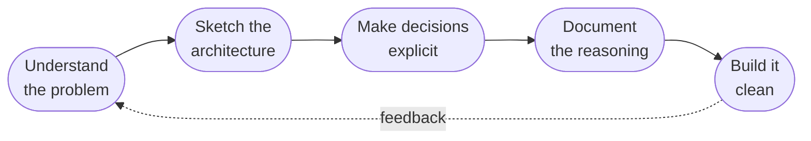

<div align="center">


<a href="https://github.com/Chisa-Sichali">
  
</a>

<br/>

[](https://www.linkedin.com/in/chisa-sichali-60b072360/)
[](https://github.com/Chisa-Sichali)


</div>

<br/>

## `~/about`

I enjoy building practical systems end to end, but for me the work starts **before** the code. I like to understand the problem, sketch the architecture, and make design decisions explicit before implementing, then document the system so others can follow the reasoning.

That's why my projects ship with more than code: design docs, architecture breakdowns, and API references. The kind of artifacts that show *how* a system works, not just that it works.

```js
const chisa = {
  role:     "Software Developer",
  focus:    ["System design", "Event-driven architecture", "API & backend design"],
  values:   ["Correctness > cleverness", "Simplicity > complexity", "Maintainability > shortcuts"],
  learning: ["Scalable backend patterns", "AI agent integration", "Modern frontend workflows"],
  askMeAbout: ["API design", "Backend architecture", "Event-driven systems", "Clean code"],
  openTo:   "Interesting problems & good conversations",
};
```

<br/>

## `~/how-i-work`



<br/>

## `~/toolbox`

<p align="center">
  
</p>

<br/>

## `~/selected-work`

<table>
  <tr>
    <td width="50%" valign="top">
      <h3><a href="https://github.com/Chisa-Sichali/MailPulse">📬 MailPulse</a></h3>
      <sub><code>TypeScript</code> · <code>Python</code></sub>
      <p>Email event-processing platform. Turns any IMAP inbox into a webhook stream, with retries, backoff, HMAC signing, analytics, and a dashboard. Ships with a full <a href="#-design--documentation">docs suite</a>.</p>
    </td>
    <td width="50%" valign="top">
      <h3><a href="https://github.com/Chisa-Sichali/Work-Logger">📝 Work-Logger</a></h3>
      <sub><code>Python</code></sub>
      <p>Automates structured weekly work logs from GitHub commit history, on a schedule. Less manual logging, consistent reports.</p>
    </td>
  </tr>
  <tr>
    <td width="50%" valign="top">
      <h3><a href="https://github.com/Chisa-Sichali/URL-Shortener">🔗 URL-Shortener</a></h3>
      <sub><code>Go</code> · <code>Redis</code></sub>
      <p>A tiny URL shortener built with Go + Redis. A hands-on dive into backend development and caching.</p>
    </td>
    <td width="50%" valign="top">
      <h3><a href="https://github.com/Chisa-Sichali/personal-portfolio">🌐 personal-portfolio</a></h3>
      <sub><code>TypeScript</code></sub>
      <p>My portfolio site: projects, skills, experience, and my journey as a software engineer.</p>
    </td>
  </tr>
</table>

<br/>

## `~/design--documentation`

System design and clear documentation matter as much to me as implementation. A working example, the **[MailPulse](https://github.com/Chisa-Sichali/MailPulse)** docs:

| | Document | What's inside |
|:-:|:--|:--|
| 🏛️ | [Architecture](https://github.com/Chisa-Sichali/MailPulse/blob/master/docs/architecture.md) | Components, data flow, and design decisions |
| 🗄️ | [Database design](https://github.com/Chisa-Sichali/MailPulse/blob/master/docs/database.md) | Schema and data modeling |
| ⚙️ | [Workers & retries](https://github.com/Chisa-Sichali/MailPulse/blob/master/docs/workers.md) | Reliable background processing and backoff |
| 🪝 | [Webhook delivery](https://github.com/Chisa-Sichali/MailPulse/blob/master/docs/webhooks.md) | Signing and delivery semantics |
| 📘 | [API reference](https://github.com/Chisa-Sichali/MailPulse/blob/master/docs/api.md) | Endpoints and usage |

<br/>

## `~/stats`

<p align="center">
  
  
</p>

<p align="center">
  
  
</p>

<br/>

## `~/connect`

<div align="center">

Always open to interesting problems, collaborations, and good conversations about software.

[](https://www.linkedin.com/in/chisa-sichali-60b072360/)
[](https://github.com/Chisa-Sichali)

<i>✨ Always curious, always building.</i>


</div>
